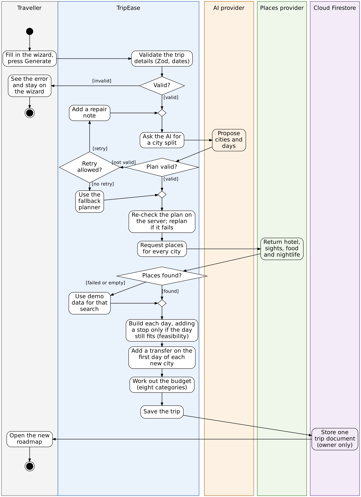

# Activity Diagram

This page has the activity diagram of the main use case, UC-2 Create a trip (see [Use Cases](use-cases.md)). It shows what happens between the moment the traveller presses **Generate my trip** and the moment the new roadmap opens, and which part of the system does each step.

## 1. Notation

The notation is the one from the course slides on activity diagrams.

| Symbol | Meaning |
|---|---|
| Filled circle | Start. There is only one, with one transition leaving it. |
| Circle with a ring around a filled centre | End. There can be more than one. |
| Long rounded rectangle | An action. |
| Arrow | A transition. It shows the order of the actions. |
| Large diamond with several exits | A decision. Every exit carries a guard in square brackets, and together the guards cover all cases. |
| Small empty diamond | A merge. Several arrows enter it and one leaves. It is used instead of letting several arrows enter an action directly. |
| Vertical columns (swimlanes) | Who performs the action. Each action is placed in the lane of the part of the system that does it. |

There are five lanes: the **Traveller**, **TripEase** (the browser and the API routes) and three outside systems, the **AI provider**, the **Places provider** and **Cloud Firestore**. The diagram has no fork and join, because all the actions are done one after another. The four place searches for a city do run at the same time in the code, but they are shown as one action.

## 2. Diagram

[](diagrams/activity.png)

## 3. Walkthrough

1. **Validate the trip details.** The wizard first calls `POST /api/trips/plan`. Every API route first checks the Firebase ID token of the signed-in user. The route then checks the trip details with a Zod schema and checks that the end date is not before the start date. If the check fails, the traveller sees an error and stays on the wizard.
2. **Ask the AI for a city split.** TripEase asks the AI provider (Groq, or a mock provider when no key is set) how many days to spend in each city.
3. **Plan valid?** The answer must pass the Zod schema and the constraint checks: the days add up to the length of the trip, no city is repeated, every city gets at least one day, there are at most 8 cities (and no more cities than days), and the plan is for the destination the traveller asked for.
4. **Retry allowed?** If the plan is not valid, TripEase retries exactly once, and only when the error is something a model can fix: a plan that breaks a constraint, or an answer that is not valid JSON in the required shape. The second request carries a repair note that says what was wrong, and goes back to the AI through the merge before the request. Timeouts, authentication errors and quota errors are not retried. If there is no retry, or if the retry fails as well, TripEase uses the deterministic fallback planner. The same fallback is used when no AI provider is configured. The saved plan records whether it came from the AI or from the fallback.
5. **Re-check the plan on the server.** The wizard then calls `POST /api/trips/generate` and sends the plan it received. A plan that arrives over the network is treated as client input, so the server checks it again and plans again if the check fails.
6. **Request places for every city.** For each city, TripEase asks the places provider for one hotel, attractions, restaurants and nightlife. If a search fails or comes back empty, demo data is used for that search only, and every place is marked with its source.
7. **Build each day.** Attractions are grouped into days by distance and visited nearest first. A stop is added to a day only if the day, travel time included, still fits in the 09:00 to 21:00 window, and time is held back for dinner. This uses the same arithmetic as the feasibility engine, so the generator does not create a day that the engine would then flag.
8. **Add a transfer.** On the first day of every city except the first one, a transfer from the previous city is added as an estimated activity, with a travel mode (car, train or flight) chosen by distance.
9. **Work out the budget.** The budget engine adds up the eight categories and compares the estimate with the budget the traveller entered. The savings suggestions are not made at this point. They are worked out when the trip page is shown.
10. **Save the trip.** The server checks the generated itinerary against its schema and returns it. The browser then saves it as one document in Cloud Firestore, which only its owner can read or change, and opens the roadmap.

If any step after the first one fails (for example, the generated itinerary does not pass its schema), the wizard shows the error message and the traveller can try again. These error paths are left out of the diagram to keep it readable.

## 4. Regenerating the image

The diagram is laid out with fixed positions, so it needs `neato -n`:

```
neato -n -Tpng -Gdpi=130 docs/diagrams/activity.dot -o docs/diagrams/activity.png
```
