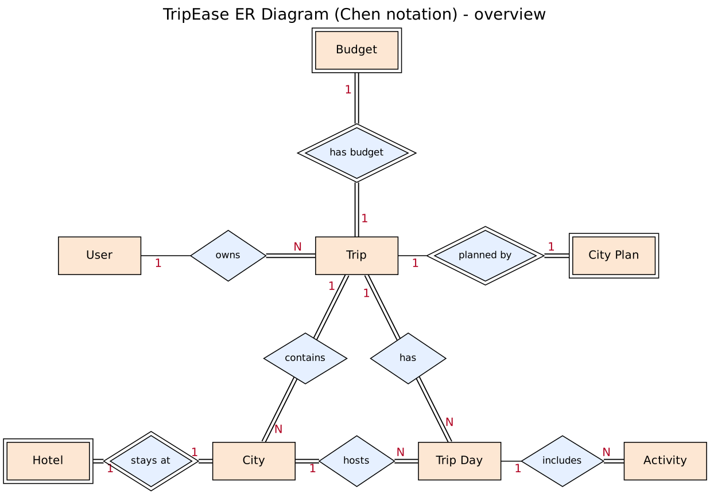
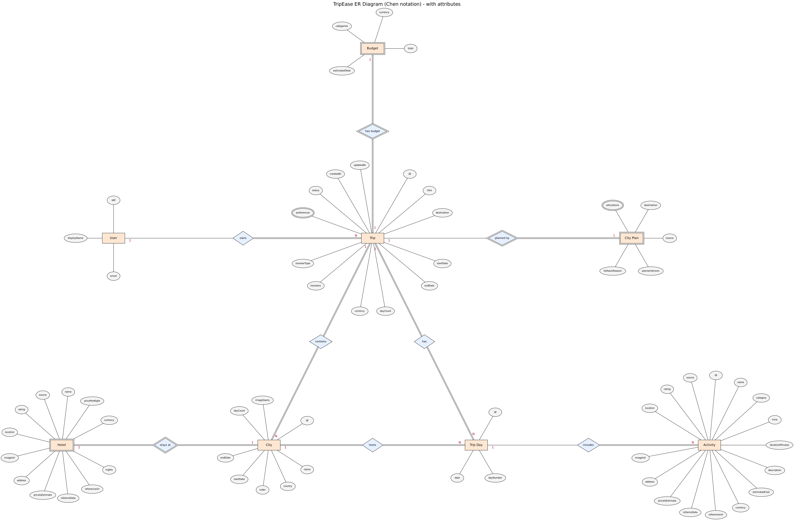

# Data Model

This page shows the data model of TripEase as an ER diagram in Chen notation. It describes the logical model: the things the app keeps track of and how they relate. How these are laid out in Firestore is explained in [section 6](#6-how-it-is-stored).

## How to read the diagram

| Symbol | Meaning |
|---|---|
| Rectangle | Entity |
| Double rectangle | Weak entity. It has no key of its own and is identified through the entity it belongs to. |
| Diamond | Relationship |
| Double diamond | Identifying relationship (the one that links a weak entity to its owner) |
| Oval | Attribute |
| Underlined oval | Key attribute |
| Double oval | Multivalued attribute (holds a list) |
| Italic oval | Composite attribute (made of several parts, listed in [section 5](#5-composite-and-multivalued-attributes)) |
| Double line | Total participation: every instance of the entity takes part in the relationship |
| `1` and `N` | Cardinality at that end of the relationship |

## 1. Overview

Entities and relationships only, so the structure is easy to see.



## 2. With attributes

The same model with every attribute drawn. The image is large, so open it in a new tab to zoom in.

[](diagrams/er-full.png)

A few things that are not drawn as ovals:

- `ownerId` on a trip is the foreign key behind the **owns** relationship, and `cityId` on a trip day is the foreign key behind **hosts**.
- A trip's cities, days, budget and city plan are drawn as relationships, not as attributes.
- `dayCount` on a trip and on a city can be worked out from the dates. We store it anyway because the roadmap and the budget use it all the time.

## 3. Entities

File paths in the last column are under `code/src/`.

| Entity | What it is | Key | Defined in |
|---|---|---|---|
| User | A traveller's account. Kept by Firebase Authentication, not in Firestore. | `uid` | `lib/services/auth.ts` |
| Trip | One planned trip: destination, dates, currency, who is travelling and their travel styles. | `id` | `types/trip.ts` |
| City | One city in a trip, with its dates, its position in the route and a search phrase for its photo. | `id` | `types/itinerary.ts` |
| Hotel | The hotel chosen for a city. Weak, because a hotel only exists as part of a city. | none (identified by its city) | `types/itinerary.ts` |
| Trip Day | One day of the trip. Points at the city where the day is spent. | `id` | `types/itinerary.ts` |
| Activity | One stop in a day: a sight, a meal, a nightlife spot or a transport step. | `id` | `types/itinerary.ts` |
| Budget | The budget breakdown of a trip. Weak, because there is exactly one per trip and it has no id. | none (identified by its trip) | `types/budget.ts` |
| City Plan | A record of how the cities were chosen: by the AI or by the fallback planner. Weak, for the same reason as Budget. | none (identified by its trip) | `types/planning.ts` |

## 4. Relationships

| Relationship | Between | Cardinality | Participation | How it is stored |
|---|---|---|---|---|
| owns | User and Trip | 1 : N | A trip must have an owner. A user may have no trips yet. | `ownerId` on the trip. Firestore rules only let the owner read or change the trip. |
| contains | Trip and City | 1 : N | Both total. A trip has at least one city and a city belongs to one trip. | The trip's `cities` list, ordered by `order`. |
| has | Trip and Trip Day | 1 : N | Both total. | The trip's `days` list. |
| hosts | City and Trip Day | 1 : N | Both total. Every city gets at least one day. | `cityId` on the day. |
| stays at | City and Hotel | 1 : 1 | Both total. | The city's `hotel` field. |
| includes | Trip Day and Activity | 1 : N | An activity must belong to a day. A day can be empty. | The day's `activities` list. |
| has budget | Trip and Budget | 1 : 1 | Both total. | The trip's `budget` field. |
| planned by | Trip and City Plan | 1 : 1 | The plan must belong to a trip. A trip may have no plan: trips saved before the planner existed do not have one. | The trip's optional `planning` field. |

The **has** relationship is partly redundant. A day already points to its city, and the city to its trip, so the trip of a day could be found that way. We draw it anyway because the days are stored directly under the trip, and the trip page reads them from there.

## 5. Composite and multivalued attributes

| Entity | Attribute | Kind | Parts |
|---|---|---|---|
| Trip | `preferences` | Multivalued | One or more travel styles: beaches, food, culture, adventure, nightlife, shopping, nature, relaxation |
| Budget | `categories` | Composite | Eight amounts: flights, hotels, food, activities, transport, shopping, misc, buffer |
| City Plan | `allocations` | Composite and multivalued | A list with one entry per city, each with a city name, a number of days and a short reason |
| Hotel, Activity | `location` | Composite | `lat`, `lng` |
| Hotel, Activity | `rating` | Composite | `value`, `count` |
| Hotel, Activity | `source` | Composite | `provider` (mock or google), `providerPlaceId`, `sourceUrl`, `sourceName` |

Values that are limited to a fixed set:

- Trip `status` is `generating` or `ready`.
- Trip `travelerType` is `solo`, `couple`, `family`, `friends` or `custom`.
- Activity `category` is one of `sightseeing`, `food`, `adventure`, `beach`, `culture`, `relaxation`, `shopping`, `nightlife` or `transport`.
- City Plan `source` is `ai` or `fallback`.

Optional attributes: on Hotel and Activity, `location`, `address`, `rating`, `imageUrl`, `source` and `priceIsEstimate` can be missing. Older trips do not have them, and neither do activities the user adds by hand. `referenceUrl` can be empty, and `fallbackReason` on a city plan is only filled when the AI plan was not used. A place with no real source is shown as "Demo data" (FR-12).

## 6. How it is stored

The model above is the logical view. In Firestore a whole trip is **one document**, `trips/{tripId}`, and everything that belongs to it sits inside that document: the cities (each with its hotel), the days (each with its activities), the budget and the city plan. We did it this way because a trip is small, with a handful of cities and a couple of dozen activities, so it stays well below Firestore's 1 MiB document limit, and the page loads and saves in a single read or write. The cost is that when the user edits one activity, the whole `days` list and the budget are written back, not just that activity. That is fine at this size.

The user is not in Firestore at all. The account lives in Firebase Authentication, and a trip refers to it through `ownerId`.

Some things in the code are not in the diagram because they are worked out when needed and never saved: travel segments between stops, the feasibility result for a day, savings suggestions, and the places returned by the places provider (these are turned into activities and hotels when an itinerary is built).

The security rules also mention a `users` collection and `itineraryItems` and `expenses` subcollections under a trip. The rules and their tests cover them, but the app does not read or write them yet, so they are left out of the diagram.

## 7. Regenerating the images

The `.dot` sources are in `docs/diagrams/`. The positions are set by hand in the files, so the layout is reproducible. From that folder:

```
neato -Tpng -Gdpi=110 er-overview.dot -o er-overview.png
neato -n -Tpng -Gdpi=70 er-full.dot -o er-full.png
```

The `-n` flag in the second command tells Graphviz to use the positions already in the file instead of working out its own.
