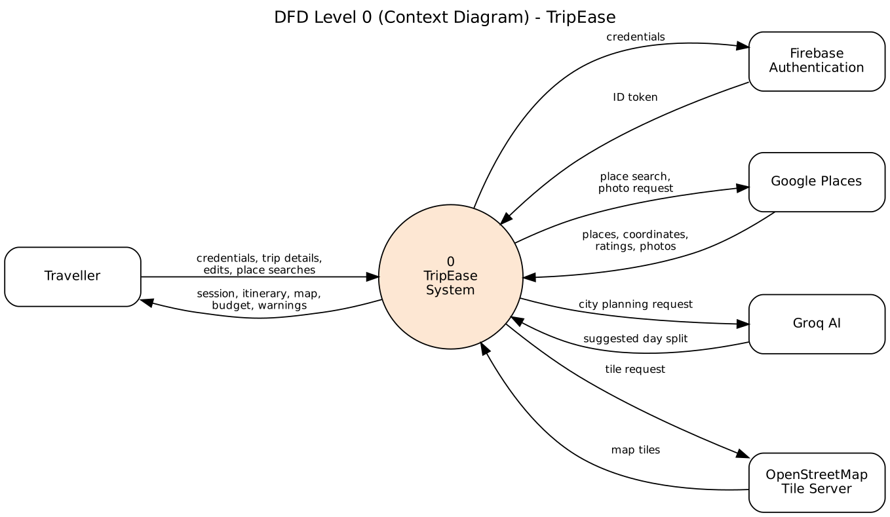
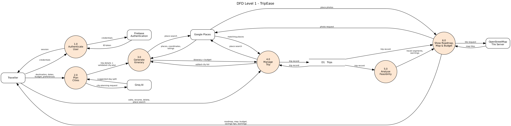
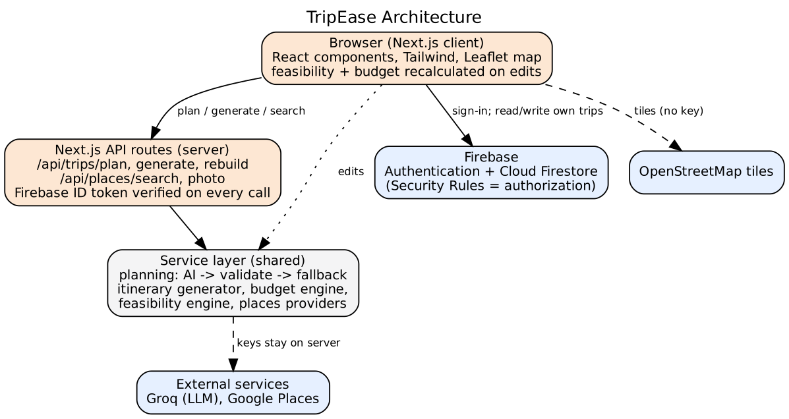

# TripEase Diagrams

The `.dot` source of each diagram is kept next to its image in `docs/diagrams/`. To regenerate an image after editing a source file, run `dot -Tpng <name>.dot -o <name>.png` (Graphviz).

## DFD Level 0 (Context Diagram)

TripEase is shown as a single process with its external entities: the traveller, Firebase Authentication, the places provider, the AI provider and the OpenStreetMap tile server.

## DFD Level 1

Notation: a circle is a process, a rounded rectangle is an external entity, and a name between two parallel lines is a data store.

- **1.0 Authenticate User:** the traveller signs in through Firebase Authentication, which returns an ID token. API routes verify this token on every request.
- **2.0 Plan Cities:** Groq AI suggests how many days to spend in each city. The suggestion is validated, and a deterministic fallback planner is used if it is missing or invalid.
- **3.0 Generate Itinerary:** places are fetched from Google Places and arranged into days. Feasibility checks decide whether an activity fits in a day, and the budget is calculated. It also rebuilds the itinerary when the city list is edited.
- **4.0 Manage Trip:** saves the trip record to D1 and handles edits, renaming, deletion and replacing a place (which searches Google Places). The budget is recalculated after every edit.
- **5.0 Analyse Feasibility:** reads the trip record and works out travel time between stops and days that are too full.
- **6.0 Show Roadmap, Map and Budget:** shows the roadmap with place photos, the map with OpenStreetMap tiles, the budget breakdown, savings suggestions and feasibility warnings.

**D1 Trips:** one Firestore document per trip, readable and writable only by its owner (enforced by Firestore security rules).

When no Google Places or Groq key is configured, the system uses built-in demo providers instead. These are internal to the system, so they are not shown as external entities.

## Architecture

