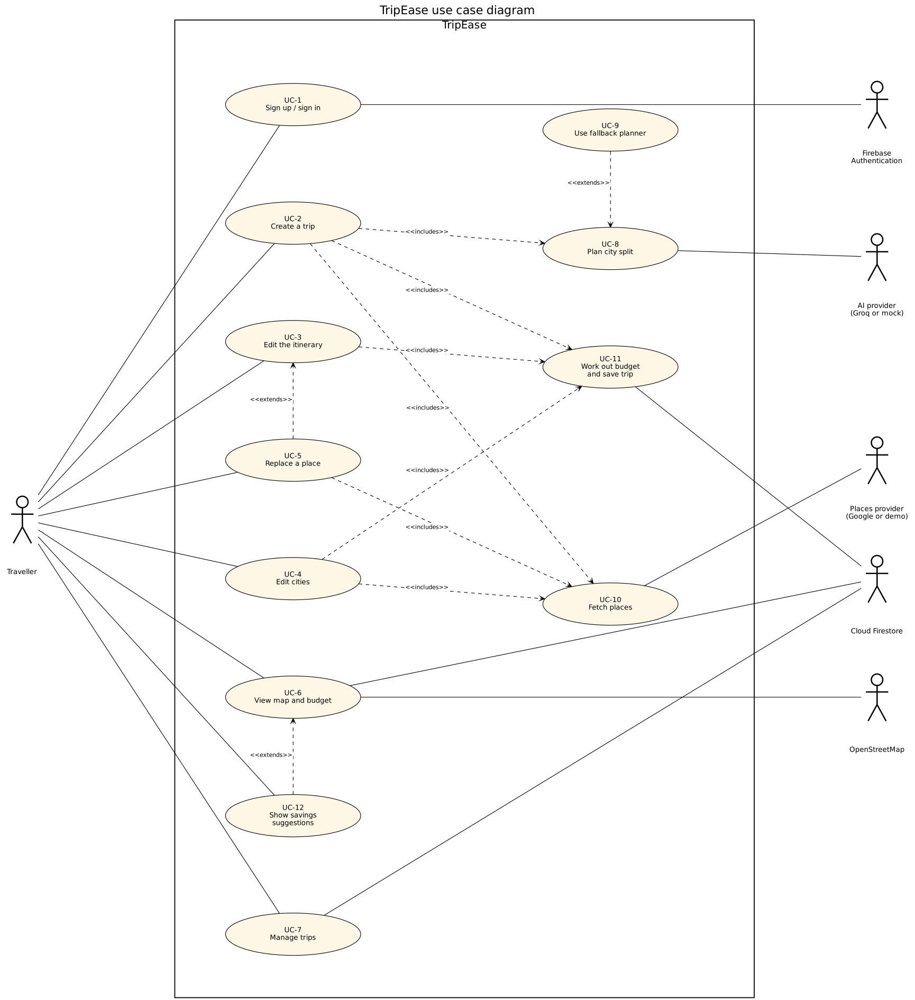

# Use Cases

This page has the use case diagram of TripEase and a description of every use case, written with the use case template from the course. UC-1 to UC-7 are the use cases from the [requirements](requirements.md) page. UC-8 to UC-12 are supporting use cases that the main ones include or extend. FR-25 to FR-27 are still planned, so they have no use cases yet.

## 1. Actors

| Actor | Category | What it does |
|---|---|---|
| Traveller | Primary actor | Uses the main functions of the system: creates trips, edits them, looks at the map and the budget. |
| Firebase Authentication | Other system | Signs the traveller up and in, with email and password or with Google. |
| Cloud Firestore | Other system | Stores the trips. Only the owner of a trip can read or change it. |
| AI provider (Groq, or a mock for testing) | Other system | Suggests how many days to spend in each city. |
| Places provider (Google Places, or our demo data) | Other system | Gives us hotels, sights, restaurants and nightlife. |
| OpenStreetMap | Other system | Gives the map tiles. |

We have no secondary actor, because the app has no admin role, and no external hardware.

## 2. Diagram

The notation is the one from the course slides. A stick figure is an actor and sits outside the system boundary, an oval is a use case, and a plain line joins an actor to the use cases it takes part in. A dashed arrow marked `<<includes>>` points to the use case that is included. A dashed arrow marked `<<extends>>` points to the use case that is extended. We kept the spelling used in the slides.

[](diagrams/usecase.png)

### Relationships between use cases

| Use case | Relationship | Use case | Why |
|---|---|---|---|
| UC-2 Create a trip | includes | UC-8 Plan city split | Every new trip needs its cities decided first. |
| UC-2 Create a trip | includes | UC-10 Fetch places | The days are filled with real places. |
| UC-2 Create a trip | includes | UC-11 Work out budget and save trip | A new trip gets a budget and is saved. |
| UC-3 Edit the itinerary | includes | UC-11 Work out budget and save trip | Every edit changes the budget and has to be saved. |
| UC-4 Edit cities | includes | UC-10 Fetch places | A new city needs places. |
| UC-4 Edit cities | includes | UC-11 Work out budget and save trip | The rebuilt trip gets a new budget and is saved. |
| UC-5 Replace a place | includes | UC-10 Fetch places | The search for a place goes to the places provider. |
| UC-9 Use fallback planner | extends | UC-8 Plan city split | Only used when the AI is not available or its plan is not accepted. |
| UC-5 Replace a place | extends | UC-3 Edit the itinerary | Only used when the traveller searches for a real place while editing an activity. |
| UC-12 Show savings suggestions | extends | UC-6 View map and budget | Only used when the trip is over budget. |

Two more notes on what the diagram leaves out. Every use case except UC-1 needs a signed-in traveller, and we did not draw an include arrow for that, to keep the diagram readable. It is a pre condition in each template below. Signing out (FR-3) is a single action, so it is not drawn as a use case. There is no generalisation, because there is only one kind of human actor.

## 3. Use case descriptions

In the flows, **AA** is an actor action, **SR** is a system response and **SA** is a system action.

### UC-1: Sign up / sign in

| | |
|---|---|
| Use case | UC-1 Sign up / sign in |
| Actors | Traveller (initiates), Firebase Authentication |
| Type | Primary |
| Purpose | Let a traveller into the app with an account. |
| Overview | The traveller creates an account or signs in, with email and password or with Google. |
| Pre condition | The traveller is not signed in. |
| Post condition | The traveller is signed in and can open the dashboard and the trip pages. |
| Requirements | FR-1, FR-2, FR-4, FR-5 |

**Typical course of events**

1. (AA) The traveller opens the sign-in page. A new traveller opens the sign-up page instead.
2. (SR) The system shows a form with email, password (at least 6 characters) and, on sign-up, an optional name. There is also a "Continue with Google" button.
3. (AA) The traveller enters the email and password and submits the form.
4. (SA) The system passes the details to Firebase Authentication, to sign in or to create the account.
5. (AA) Firebase Authentication accepts the details and signs the traveller in.
6. (SR) The system opens the trip wizard if the traveller had started a trip on the landing page. Otherwise it opens the dashboard.

**Alternate flow**

- **Step 1:** The traveller was sent here because they opened the dashboard or a trip page without being signed in.
- **Step 3:** The traveller chooses "Continue with Google" and finishes in the Google pop-up. The flow continues at step 5.

**Exceptional flow**

- **Step 5:** Firebase Authentication refuses (wrong email or password, an account that already exists, a weak password, too many attempts, a network problem), or the Google window is closed. The system shows a message and the traveller stays on the same page.

### UC-2: Create a trip

| | |
|---|---|
| Use case | UC-2 Create a trip |
| Actors | Traveller (initiates). The AI provider, the places provider and Cloud Firestore take part through UC-8, UC-10 and UC-11. |
| Type | Primary |
| Purpose | Turn a few answers into a full trip with cities, days, hotels, activities and a budget. |
| Overview | The traveller goes through the wizard. The system decides the cities, fills the days with places, works out the budget and saves the trip. |
| Pre condition | The traveller is signed in. |
| Post condition | The trip is saved under the traveller's account and its page is open. |
| Includes | UC-8 Plan city split, UC-10 Fetch places, UC-11 Work out budget and save trip |
| Requirements | FR-5 to FR-12, FR-23 |

**Typical course of events**

1. (AA) The traveller selects "Create new trip" on the dashboard, or arrives from the landing page after signing up.
2. (SR) The system opens the wizard. If the traveller started a trip on the landing page, destination, dates, budget and currency are already filled in.
3. (AA) The traveller goes through the steps: destination, dates, budget and currency, travellers, travel style, and a final review.
4. (SR) The system lets the traveller go to the next step only when the current one is valid.
5. (AA) The traveller selects "Generate my trip".
6. (SA) The system decides the cities (UC-8). The loading screen shows the cities it chose.
7. (SA) The system fetches places for each city (UC-10), arranges them into days and checks the result.
8. (SA) The system works out the budget and saves the trip (UC-11).
9. (SR) The trip page opens with the roadmap, the map and the budget.

**Alternate flow**

- **Step 2:** There is no landing-page draft, so the wizard starts with default values.
- **Step 3:** The traveller goes back to a previous step and changes an answer.

**Exceptional flow**

- **Step 4:** The destination is shorter than 2 characters, the end date is before the start date, the budget is not above 0, or there are no travellers. The "Next" button stays disabled.
- **Steps 6 to 8:** A service fails, the session has expired, or the server rejects the details (for example, no travel style was chosen). The wizard shows the error message and goes back to the review step with the answers still filled in.

### UC-3: Edit the itinerary

| | |
|---|---|
| Use case | UC-3 Edit the itinerary |
| Actors | Traveller (initiates). Cloud Firestore takes part through UC-11. |
| Type | Primary |
| Purpose | Let the traveller change the plan to what they actually want. |
| Overview | The traveller adds, edits, removes or reorders activities, or changes the hotel of a city. The budget, the warnings and the map follow the change. |
| Pre condition | The traveller is signed in, owns the trip and has the trip page open. |
| Post condition | The change is saved and the budget matches the new plan. |
| Includes | UC-11 Work out budget and save trip |
| Extended by | UC-5 Replace a place |
| Requirements | FR-15, FR-16, FR-18, FR-22, FR-23 |

**Typical course of events**

1. (AA) The traveller adds an activity to a day, edits or removes one, drags an activity to a new position, or changes the hotel of a city.
2. (SR) For an added or edited activity, or for a hotel change, the system opens a form with the details.
3. (AA) The traveller fills in the form and saves it.
4. (SA) The system works out the new budget and saves the change (UC-11).
5. (SR) The roadmap, the map, the budget and the warnings for each day update.

**Alternate flow**

- **Step 1:** Removing or dragging an activity needs no form, so the flow goes straight to step 4.
- **Step 2:** While the form is open, the traveller can search for a real place (UC-5).

**Exceptional flow**

- **Step 3:** In the activity form, the name is empty or the reference link is not a full URL. The form shows a message, stays open and nothing is saved.

### UC-4: Edit cities

| | |
|---|---|
| Use case | UC-4 Edit cities |
| Actors | Traveller (initiates). The places provider and Cloud Firestore take part through UC-10 and UC-11. |
| Type | Primary |
| Purpose | Let the traveller change which cities are visited and for how many days. |
| Overview | The traveller adds, removes, renames or re-times cities. The system checks the new list and rebuilds only the cities that are new or changed. |
| Pre condition | The traveller is signed in, owns the trip and has the trip page open. |
| Post condition | The trip has the new cities and days, a new budget and the updated plan. Cities that were not touched keep their activities. |
| Includes | UC-10 Fetch places, UC-11 Work out budget and save trip |
| Requirements | FR-9, FR-17 |

**Typical course of events**

1. (AA) The traveller selects "Edit cities" on the roadmap.
2. (SR) The system shows the cities with their number of days.
3. (AA) The traveller adds a city, removes one, renames one or changes its days.
4. (SR) The system checks the list while the traveller types. The days must add up to the length of the trip, no city can be repeated, every city needs at least 1 day, there can be at most 8 cities, and no more cities than days.
5. (AA) The traveller saves the list.
6. (SA) The server checks the list again and rebuilds the trip. Cities that were not changed keep their activities, and new cities get places from the places provider (UC-10).
7. (SA) The system works out the budget and saves the trip, together with a note that the cities were edited by the traveller (UC-11).
8. (SR) The roadmap, the map and the budget show the new cities.

**Alternate flow**

- **Step 3:** The last remaining city cannot be removed, and a city cannot be added once there are as many cities as days. Those buttons are disabled.

**Exceptional flow**

- **Step 4:** The list breaks one of the rules. The system shows the first problem, the "Save" button is disabled and nothing is saved.
- **Steps 6 and 7:** The server refuses the list or something fails. The dialog shows the error and the trip stays as it was.

### UC-5: Replace a place

| | |
|---|---|
| Use case | UC-5 Replace a place |
| Actors | Traveller (initiates). The places provider takes part through UC-10. |
| Type | Primary |
| Purpose | Let the traveller swap an activity for a real place, so that its location and source stay attached. |
| Overview | In the activity form, the traveller searches for a place, picks one, and the form is filled with its details. |
| Pre condition | The traveller is signed in and has the add or edit activity form open (UC-3). |
| Post condition | The activity refers to the chosen place and keeps its location and source. |
| Includes | UC-10 Fetch places |
| Extends | UC-3 Edit the itinerary |
| Requirements | FR-12, FR-16 |

**Typical course of events**

1. (AA) The traveller types at least 2 characters in "Replace with a real place" and starts the search.
2. (SA) The system asks the places provider (UC-10) for matching places in the destination of the trip. It looks for restaurants if the activity is a food activity and for attractions otherwise.
3. (SR) The system lists the matches with name, rating, address, coordinates and estimated price. Demo places are marked "Demo".
4. (AA) The traveller picks a place.
5. (SR) The system fills the form with the name, category, description, duration, estimated cost and source link of the place, and keeps its location and source attached.
6. (AA) The traveller saves the form. The flow continues at step 4 of UC-3.

**Alternate flow**

- **Step 4:** No place matched. The system suggests a broader search or typing the name by hand.
- **Step 5:** The traveller types over the name after picking a place. The place is detached, so the activity has no location or source any more.

**Exceptional flow**

- **Step 2:** The live provider fails. The system shows demo places and a notice that says so.
- **Step 2:** The search cannot be done at all (for example a network error or an expired session). The form shows a message and the traveller can still type a name.

### UC-6: View map and budget

| | |
|---|---|
| Use case | UC-6 View map and budget |
| Actors | Traveller (initiates), OpenStreetMap, Cloud Firestore |
| Type | Primary |
| Purpose | Show the plan on a map and show what it costs. |
| Overview | The traveller opens a trip and looks at the roadmap with the map beside it, then at the budget. |
| Pre condition | The traveller is signed in and owns the trip. |
| Post condition | None. This use case only reads the trip. |
| Extended by | UC-12 Show savings suggestions |
| Requirements | FR-19 to FR-23 |

**Typical course of events**

1. (AA) The traveller opens a trip from the dashboard.
2. (SA) The system loads the trip from Cloud Firestore and keeps listening for changes.
3. (SR) The Roadmap tab shows the cities and days with the estimated travel time between stops. A day that does not fit between 09:00 and 21:00 is marked red, and a tight day amber. The map is next to it.
4. (AA) The traveller sets the map to the whole trip, a city or a day, or selects a pin or a place in the roadmap.
5. (SR) The map shows the matching pins on OpenStreetMap tiles. For a day it joins the stops in order with a line, and for the whole trip it joins the cities. Selecting a pin opens the place in the roadmap and the other way round.
6. (AA) The traveller opens the Budget tab.
7. (SR) The system shows the budget, the estimated cost, how much is left or over, and the cost of each category: hotels, flights, food, activities, transport, shopping, miscellaneous and emergency buffer.

If the estimate is above the budget, UC-12 adds its suggestions after step 7.

**Alternate flow**

- **Step 3:** On a small screen the traveller shows or hides the map with a button.

**Exceptional flow**

- **Step 2:** The trip cannot be loaded. The page shows a message. If the trip does not exist or is not the traveller's, the page says so and links back to the dashboard.
- **Step 5:** A place without coordinates is not on the map. The map says how many places are missing.

### UC-7: Manage trips

| | |
|---|---|
| Use case | UC-7 Manage trips |
| Actors | Traveller (initiates), Cloud Firestore |
| Type | Primary |
| Purpose | Let the traveller find, open, rename and delete their trips. |
| Overview | The dashboard lists the traveller's own trips. From there a trip can be opened or deleted, and on the trip page it can be renamed. |
| Pre condition | The traveller is signed in. |
| Post condition | The dashboard and the trip page show the current trips and titles. |
| Requirements | FR-13, FR-14 |

**Typical course of events**

1. (AA) The traveller opens the dashboard.
2. (SA) The system loads the traveller's trips from Cloud Firestore and keeps listening for changes.
3. (SR) The system shows each trip as a card with its title, dates, number of travellers and budget. Trips that have not ended yet are under "Your trips" and finished ones under "Past trips".
4. (AA) The traveller opens a trip.
5. (SR) The trip page opens (UC-6).

**Alternate flow**

- **Step 4:** Delete: the traveller selects the bin icon on a card and the card asks for confirmation. On "Confirm" the system deletes the trip from Cloud Firestore and the card disappears. On "Cancel" nothing happens.
- **Step 4:** Rename: on the trip page the traveller selects the pencil next to the title, types a new title and saves. The system stores the new title. An empty title is not saved.
- **Step 3:** The traveller has no trips yet. The system shows an empty page with a button to create the first trip (UC-2).

**Exceptional flow**

- **Step 2:** The trips cannot be loaded. The dashboard shows a message.
- **Step 4:** A delete fails. The card shows the error and the trip stays.

### UC-8: Plan city split

| | |
|---|---|
| Use case | UC-8 Plan city split |
| Actors | AI provider. The system starts it as part of UC-2. |
| Type | Secondary |
| Purpose | Decide which cities to visit and how many days to spend in each. |
| Overview | The AI provider suggests a split and the system accepts it only if it passes our own checks. The AI does not pick places or prices. |
| Pre condition | The traveller has finished the wizard. |
| Post condition | The system has a valid city plan, whatever the AI did. |
| Extended by | UC-9 Use fallback planner |
| Requirements | FR-8, FR-9, FR-10 |

**Typical course of events**

1. (SA) The system sends the trip details (destination, dates, number of days, travellers, budget, currency and travel styles) to the AI provider and asks for a split of the days between cities.
2. (AA) The AI provider answers with a list of cities, the days for each one and a short reason.
3. (SA) The system checks the answer. It must be for the same destination, the days must add up to the length of the trip, no city can be repeated, every city needs at least 1 day, there can be at most 8 cities, and no more cities than days.
4. (SR) The plan is accepted and recorded together with the planner that made it. The loading screen shows the cities and marks the route as AI planned.

**Alternate flow**

- **Step 3:** The answer is not valid JSON in the expected shape, or it fails the checks. The system asks the AI provider once more and tells it what was wrong.

**Exceptional flow**

- **Steps 1 to 3:** There is no AI key, the provider fails, it takes longer than 20 seconds, or the second answer is still not valid. The system goes to UC-9.

### UC-9: Use fallback planner

| | |
|---|---|
| Use case | UC-9 Use fallback planner |
| Actors | None. This is done by the system alone. |
| Type | Secondary |
| Purpose | Make sure a trip can always be planned, even without the AI. |
| Overview | The system splits the days between cities with its own rules. |
| Pre condition | The AI is not available, or its plan was not accepted in UC-8. |
| Post condition | A valid city plan, recorded as "fallback" with the reason. |
| Extends | UC-8 Plan city split |
| Requirements | FR-10 |

**Typical course of events**

1. (SA) The system splits the days between cities for the destination, using its own planner.
2. (SA) The system runs the same checks as in step 3 of UC-8.
3. (SA) The system records the plan as "fallback", with the reason.
4. (SR) The loading screen marks the route as planned by TripEase and says that AI planning is not available right now. It is not shown as an error.

### UC-10: Fetch places

| | |
|---|---|
| Use case | UC-10 Fetch places |
| Actors | Places provider. The system starts it as part of UC-2, UC-4 or UC-5. |
| Type | Secondary |
| Purpose | Get real places for a trip. |
| Overview | The system asks the places provider for hotels, sights, restaurants and nightlife of a city, or for the words the traveller searched for. |
| Pre condition | The caller has a destination and what to look for. |
| Post condition | The caller has a list of places that each say where they came from. |
| Requirements | FR-11, FR-12 |

**Typical course of events**

1. (SA) The system asks the places provider for places in a city, or for the search words of the traveller.
2. (AA) The places provider returns places with name, location, rating, estimated price, photo link and source.
3. (SA) The system keeps answers from the live provider for 10 minutes (at most 500 entries), so the same search is not paid for twice.
4. (SR) The places go back to the caller.

**Exceptional flow**

- **Step 2:** There is no Google key, the live search fails or it finds nothing. The system uses demo places instead. They are marked "Demo data".

### UC-11: Work out budget and save trip

| | |
|---|---|
| Use case | UC-11 Work out budget and save trip |
| Actors | Cloud Firestore. The system starts it as part of UC-2, UC-3 and UC-4. |
| Type | Secondary |
| Purpose | Keep the budget and the saved trip in line with the plan. |
| Overview | After a trip is built or changed, the system works out the budget and writes the trip to Cloud Firestore. |
| Pre condition | A trip was built or changed. |
| Post condition | The stored trip and its budget agree with each other. |
| Requirements | FR-18, FR-23 |

**Typical course of events**

1. (SA) The system works out the budget from the cities, the days, the activities and the number of travellers: hotels, flights, food, activities, transport, shopping, miscellaneous and the emergency buffer, and the total estimate.
2. (SA) The system writes the changed parts of the trip to its document in Cloud Firestore (a new trip is created with the traveller as owner) and updates the time of the last change.
3. (AA) Cloud Firestore accepts the write if the traveller is signed in and owns the trip.

**Exceptional flow**

- **Step 3:** Cloud Firestore refuses the write because the traveller is not signed in or does not own the trip. Nothing is saved.

### UC-12: Show savings suggestions

| | |
|---|---|
| Use case | UC-12 Show savings suggestions |
| Actors | Traveller (initiates) |
| Type | Secondary |
| Purpose | Help the traveller bring an over-budget trip back within budget. |
| Overview | When the estimate is above the budget, the Budget tab lists up to three ways to save and the traveller can apply one. |
| Pre condition | The Budget tab is open and the estimated total is above the budget. |
| Post condition | If a suggestion was applied, the trip and its budget are changed and saved. |
| Extends | UC-6 View map and budget |
| Requirements | FR-24 |

**Typical course of events**

1. (SR) The system shows a warning with the amount by which the trip is over budget.
2. (SR) The system lists up to three ways to save, each with the estimated saving: a more modest hotel in the city with the priciest hotel, a shared tour instead of the most expensive non-food activity, and local restaurants instead of hotel dining.
3. (AA) The traveller selects "Apply" on one of them.
4. (SA) The system changes the trip. The hotel is replaced by a budget option at 70% of the nightly price and marked as demo data, the activity becomes a shared tour at 40% of its cost, or the food costs go down by 15%. The system then works out the budget again and saves the trip.
5. (SR) The Budget tab shows the new numbers.

**Alternate flow**

- **Step 3:** The traveller ignores the suggestions and leaves the trip as it is.

## 4. Regenerating the image

The `.dot` source and the stick figure it uses (`actor.png`) are in `docs/diagrams/`. The positions are set by hand in the file, so the layout stays the same. From that folder:

```
neato -n -Tpng -Gdpi=80 usecase.dot -o usecase.png
```
